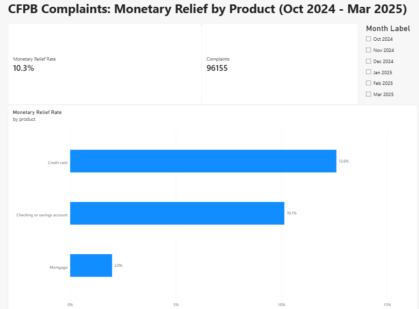
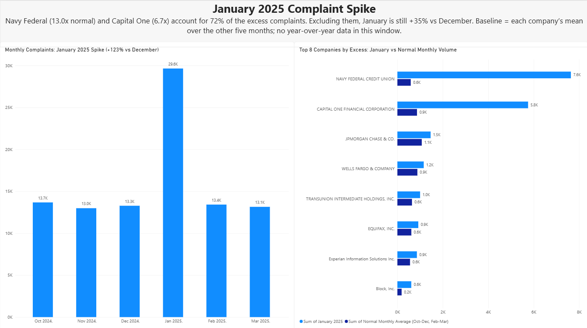
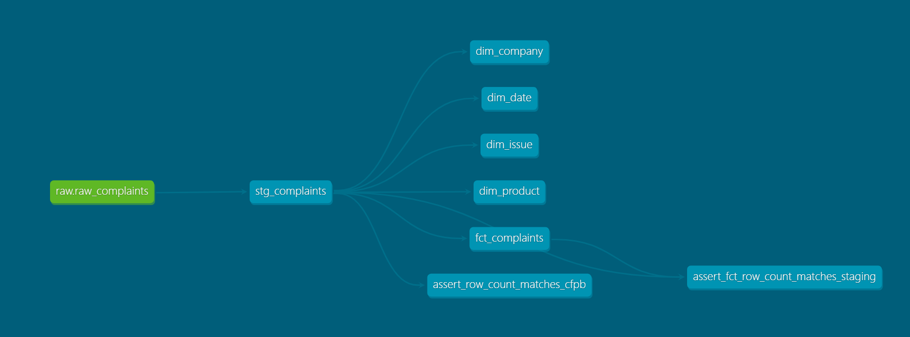
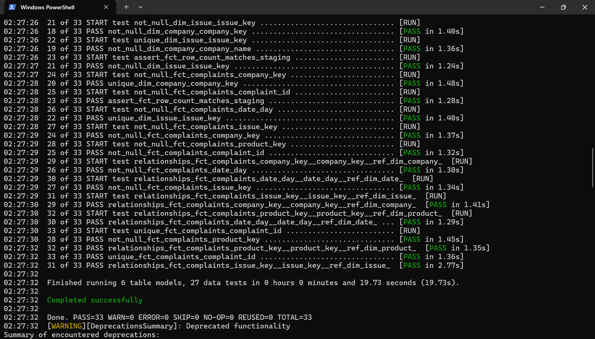

# CFPB complaint analytics (Oct 2024 to Mar 2025)

**Questions:** (1) Which companies explain the January 2025 spike in consumer complaints? (2) How do monetary-relief outcomes differ across mortgages, credit cards and checking/savings accounts?

**Stack:** BigQuery (free sandbox) · dbt Core · SQL · Python (pandas, SciPy) · Power BI · GitHub

## Key findings

- **January 2025 was a one-month spike:** 29,644 complaints, up 123% from December (13,279), then back to 13,419 in February.
- **Two companies drove most of it.** Navy Federal Credit Union received 7,638 complaints in January against a normal monthly average of 589 (13.0x). Capital One received 5,754 against 864 (6.7x). Together they account for 72% of all company-level excess complaints. Without them January is still up 35% on December, so the spike was not *only* these two.
- **Monetary relief differs by product:** credit cards 12.6% (95% CI 12.3 to 12.9), checking/savings 10.1% (9.9 to 10.4), mortgages 2.0% (1.7 to 2.3). The difference is statistically significant (chi-square p < 0.001) and moderate in size (Cramér's V = 0.11).




## How it fits together

```
CFPB CSV  ->  BigQuery raw table (all STRING)  ->  dbt staging (typing, cleaning)
          ->  star schema (fct_complaints + 4 dimensions)  ->  Power BI + Python (SciPy)
```

- **Warehouse and models:** the raw CSV is loaded unchanged into BigQuery as text. dbt does all typing and cleaning in `stg_complaints`, then builds `fct_complaints` (one row per complaint) with `dim_company`, `dim_product`, `dim_issue` and `dim_date`.
- **Data quality:** 27 automated dbt tests (unique and not-null keys, accepted product values, foreign-key relationships from the fact table to every dimension, and two row-count reconciliations: staging matches the 96,155 rows in the CFPB file, and the fact table matches staging). `dbt build` passes 33 of 33 steps (6 models plus 27 tests).
- **Statistics:** `python/01_spike_and_relief_analysis.py` computes the spike baseline and the relief rates, and writes small aggregate CSVs to `exports/`.
- **Dashboard:** `powerbi/cfpb_complaints.pbix` connects to the BigQuery star schema (import mode) and adds the Python results from `exports/`. It contains an imported copy of the public CFPB data.




## Method notes

- **Spike baseline:** for each company, the mean monthly complaint count over the other five months in the window. Companies with at least 100 January complaints are tested (30 companies) using a one-sided Poisson tail probability with a Bonferroni correction. Complaint counts are over-dispersed, so the p-values are a screening tool; the ratio to baseline and the excess volume are the headline numbers.
- **Monetary relief rate:** share of complaints whose recorded company response is "Closed with monetary relief". Intervals are Wilson 95% intervals.
- **Cross-check:** the Python script gives identical results whether it reads BigQuery or the raw CSV (`--source csv`).

## KPI dictionary

| Metric | Definition |
|---|---|
| Complaints | Count of rows in `fct_complaints` (one row per complaint ID) |
| Monetary relief rate | Complaints with response "Closed with monetary relief" / complaints |
| Ratio vs baseline | January complaints / mean monthly complaints in the other five months |
| Excess complaints | January complaints minus the company's baseline mean |

## Limitations

- **No year-over-year comparison.** The window is six months, so "normal" volume means the other months in the same window. A seasonal January effect cannot be ruled out from this data alone.
- **Counts, not rates.** Complaints are not adjusted for company size or number of customers, so a bigger bank having more complaints says nothing about it being worse.
- **Self-reported and unverified.** The CFPB publishes complaints as submitted; they are not a random sample of consumer experience, and filing campaigns can inflate a company's count (one plausible explanation for a spike, not one tested here).
- **Relief is a company response category,** not a measured consumer outcome.
- **Three products only.** This is the slice downloaded (checking/savings, credit card, mortgage), not the full CFPB database. At 96K rows this is a modest dataset; the project is about method and rigor, not scale.
- **Sandbox tables expire.** BigQuery sandbox tables last 60 days, so screenshots are included, and everything can be rebuilt from the steps below.

## Reproduce

1. Download the CFPB data (see [data/README.md](data/README.md)) and run `python/00_prepare_for_bigquery.py`.
2. Load the result into BigQuery as `cfpb.raw_complaints` ([docs/bigquery_setup.md](docs/bigquery_setup.md)).
3. In `dbt/`, copy `profiles.yml.example` to `profiles.yml`, then run `dbt build --profiles-dir .` (dbt Core 1.12 with dbt-bigquery 1.12; if dbt tries to open a browser login, set `DBT_ENGINE_MANAGE_STATE=0` first).
4. Run `python python/01_spike_and_relief_analysis.py`.
5. Open `powerbi/cfpb_complaints.pbix` in Power BI Desktop.

License: MIT (code only). CFPB data is public; see [data/README.md](data/README.md).
